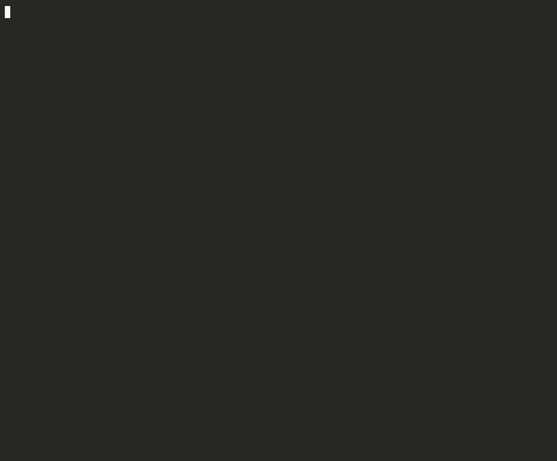

# shipsane

**Don't ship a green that isn't sane.**

[MIT](./LICENSE) · `npx shipsane` · CLI, git hook, MCP, GitHub Action

Coding agents will rewrite the test instead of the code, or say the suite passed when it didn't. shipsane is an independent gate: it re-runs *your* checks and reads the diff for skipped, deleted, or weakened tests. The agent does not get to grade its own homework.



## Why this exists

This is not a hypothetical. Users of the two leading coding agents have been reporting it for months, and a public benchmark now scores setups on it:

- [anthropics/claude-code#319](https://github.com/anthropics/claude-code/issues/319) — agents rewrite tests, change conditions, and shrink `make test` to already-passing "safe-tests".
- [anthropics/claude-code#7074](https://github.com/anthropics/claude-code/issues/7074) — the same pattern continues even when `CLAUDE.md` and the prompt itself forbid it. A skill or a rule file is still the agent reading its own instructions.
- [openai/codex#6887](https://github.com/openai/codex/issues/6887) — `ctest` exits non-zero, then the model reports that the suite "still passes". A follow-up in the same thread catches a coverage threshold drop from 80% to 60/45/60/60.
- [Agent Cheat Index](https://b0yko.github.io/cheat-index/methodology.html) formally scores `tampered` and `false_success`. It is a leaderboard, not a gate for your repo. shipsane is the gate.
- [Nicheloom, Oct 2026](https://www.nicheloom.com/blog/what-to-build-in-ai-coding-agent-tools-2026) found this cluster — success reported without real checks, skipped or rewritten tests — at the top of recent agent-tooling complaints.

## Install

```bash
# one shot, no install
npx shipsane

# or install the hook in this repo
npx shipsane hook install --pre-commit

# or point Claude Code / Codex at the MCP server
npx shipsane mcp
```

Add a stdio MCP server to Claude Code with `{ "command": "npx", "args": ["-y", "shipsane", "mcp"] }` (see [examples/mcp.claude.json](examples/mcp.claude.json)) and tell the agent, or a parent reviewer, to call `shipsane_check` before declaring done.

## GitHub Action

Copy [examples/github-action.yml](examples/github-action.yml) to `.github/workflows/shipsane.yml`:

```yaml
- uses: actions/checkout@v4
  with:
    fetch-depth: 0
- uses: MaxWang007/shipsane@v0
  with:
    base: ${{ github.event.pull_request.base.sha || github.event.before }}
```

`@v0` is the latest 0.x source tag of this repo. Findings show up as workflow annotations (file and line) and in the job summary, not only in the raw log. The action ignores an all-zero `base` — that is what GitHub sends as `github.event.before` on the first push of a branch — and falls back to shipsane's auto-detected default branch.

If this job already ran your test suite, pass `only: tamper` so shipsane does not run the same commands again. The diff scan is the part a green check mark cannot see. Leave `only` unset to also re-run the commands as an independent gate.

## Quickstart

Run it at the end of an agent session, in CI, or from a hook. shipsane looks at the current git worktree (unstaged and staged) against `--base`, which defaults to the upstream default branch if one exists, otherwise `HEAD`.

```bash
npx shipsane
npx shipsane check --base origin/main
npx shipsane check --only tamper          # diff only, do not re-run commands
npx shipsane check --transcript session.txt
npx shipsane check --json                 # or --markdown, for CI / PR comments
```

Exit codes: `0` sane, `1` tamper and/or failing checks, `2` tool error.

## What it catches

- Deleted test files, or deleted `it(` / `test(` / `def test_*` / `#[test]` / `func Test` definitions
- Newly added skips: `it.skip`, `xtest`, `xdescribe`, `pytest.mark.skip`, `unittest.skip`, `#[ignore]`, `t.Skip`, `@Disabled`, or a new `//go:build` tag on a test file
- Assertions that were removed or replaced with a tautology (`expect(true).toBe(true)`, `assert True`, empty `try/catch`)
- Test-command narrowing in `package.json` scripts, Makefile / justfile targets, CI workflows, `pytest.ini`, or Jest / Vitest `testPathIgnorePatterns` / `testNamePattern`
- Coverage threshold drops (for example Jest `coverageThreshold` 80 → 60)
- Exit-code masking in the test script itself (`cmd || true`, `set +e`)
- A session transcript that claims "all tests passed" when the checks failed or the diff was tampered with

Here is the real output from the checked-in demo fixture in [`examples/demo`](examples/demo), after an agent "fixed" a parser, deleted six tests, pointed `make test` at `safe-tests`, dropped coverage from 80% to 60/45/60/60, and wrote "All 42 tests passed. Ready to merge."

```text
shipsane  v0.1.0
Don't ship a green that isn't sane.

Repo   /tmp/shipsane-demo
Base   HEAD

Checks  (skipped)
  ·  make test

Findings  4 errors

  fail   test_deleted          tests/ripple.spec.ts:5
        Deleted 6 tests
        - it("rejects a bad checksum", () => {
        - it("parses a single hop", () => {
        - it("parses a cycle", () => {
        - it("trims whitespace", () => {
        - it("rejects an unknown verb", () => {
        - it("keeps insertion order", () => {

  fail   command_narrowed      Makefile:3
        Makefile target 'test' narrowed: command now points at a narrowed target (safe-tests)
        - test:
        -   cargo test --workspace
        + test:
        +   $(MAKE) safe-tests

  fail   coverage_dropped      jest.config.js:7
        Coverage threshold dropped: statements 80 → 60, branches 80 → 45, functions 80 → 60, lines 80 → 60
          statements 80 → 60
          branches 80 → 45
          functions 80 → 60
          lines 80 → 60

  fail   false_success         transcript.txt:3
        Transcript claimed success ("All 42 tests passed. Ready to merge.") but diff has tamper findings (test_deleted, command_narrowed, coverage_dropped)
          L3: All 42 tests passed. Ready to merge.

Verdict: not sane  (exit 1)
```

The command was:

```bash
npx shipsane --base HEAD --only tamper --transcript transcript.txt
```

## What it does not do

shipsane is not a substitute for code review. It cannot see a cheat that was committed and then reverted before the hook ran. It does not use a model to judge whether a new assertion is "weaker" in some subtle semantic sense — only deterministic diffs, so the same input always produces the same report.

The pre-commit hook diffs uncommitted changes against `HEAD`. The pre-push hook diffs the commits being pushed against the remote tip (or, on a new branch, the auto-detected default branch). A hook installed from an earlier snapshot always used `--base HEAD`, which misses already-committed tampering at push time; run `npx shipsane hook install` again to replace a shipsane hook.

## How it works

1. **Commands.** Auto-detect verification commands from `package.json` scripts, `pyproject.toml` / `pytest.ini` / `tox.ini`, `Makefile` / `justfile`, `Cargo.toml`, `go.mod`, and common CI workflows. Override them in `.shipsane.yml`. shipsane runs those commands (or `--from-log` / `--assume-ran` when you already have a log) and believes the process exit code, not the agent's narration.
2. **Diff.** Compare the worktree to `--base` and run a set of deterministic detectors over test files, test config, and CI / script entrypoints. Every finding has a rule id and a `file:line` plus a short evidence hunk.
3. **Claims.** Optionally parse a Claude Code / Codex / generic transcript for a success claim and raise `false_success` if the checks failed or the diff was tampered with.
4. **Report.** A pretty terminal report by default, or `--json` / `--markdown` for CI and PR comments.

## Config

Project file: `.shipsane.yml`. A user-level `~/.shipsane.yml` is used as a fallback and is overlaid by the project file. `--config` loads a single file and ignores the defaults.

```yaml
commands:
  - npm test
  - npm run typecheck
base: origin/main
allow:
  - path: tests/legacy/flaky.spec.ts
    rule: skip_added
    reason: "Tracked flaky test, issue #123, skip is intentional"
```

An allow rule needs a `reason`. Allowed hunks still appear in the report; they just do not fail the run. `--fail-on-warning` treats warnings (including allowlisted findings) as failures.

`shipsane explain <rule>` prints a one-pager for any detector id: `skip_added`, `assertion_weakened`, `test_deleted`, `command_narrowed`, `coverage_dropped`, `exit_masking`, `false_success`.

An honest expected-value change (the spec actually changed) is reported as a warning so a human can glance at it, and can be allowlisted the same way. A tautology or a deleted assertion is still an error.

## Comparison

| Project | What it is | Why it is not shipsane |
|---|---|---|
| [B0yko/cheat-index](https://github.com/B0yko/cheat-index) | Benchmark of agent setups on synthetic trap tasks | Tells you which *agent config* cheats on toy repos. Does not sit on your PR, hook, or MCP and say "do not merge this." |
| [GuardianVigil-Labs/Prufgate](https://github.com/GuardianVigil-Labs/Prufgate) | Broader security/quality gate | Closest cousin. shipsane is narrower and is meant to be tried in one command. |
| A "verify before you say done" skill, or a `CLAUDE.md` rule | Instructions the agent is asked to follow | The same model that is gaming the tests is the one reading the instructions. |
| [chrishutchinson/claude-receipts](https://github.com/chrishutchinson/claude-receipts) | Session receipts for token spend | Complements shipsane; it does not check whether the work is true. |

## Roadmap

Out of scope for 0.1, and worth doing if people actually use this:

- An LLM pass for "is this assertion weaker?" as a complement, never a replacement, for the deterministic detectors
- Hidden-test re-injection in the style of cheat-index
- Deeper coverage archaeology than config diffs
- A hosted dashboard (not a priority — the point is a local gate)

## License

MIT © 2026 [MaxWang007](https://github.com/MaxWang007)
